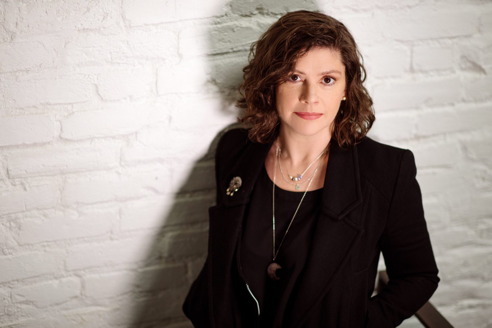
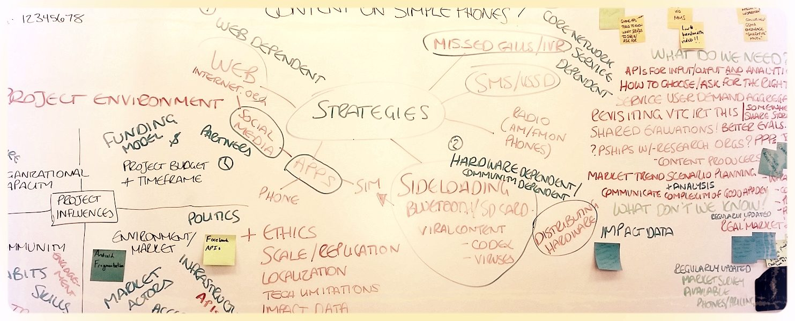

<section class="panel">

# I’m Laura. I work with teams to help make technologies that make things better.

Technology can embody the best and worst of human nature. It can provide connection and opportunity; or deepen inequality, and put people in harm’s way.

Principled technology practice means thinking about gaps in governance, ethics, digital knowledge, infrastructure, money, and power. It means making informed, ethical decisions, and looking at every idea from the perspective of the most vulnerable person.

I help people understand and solve problems together, drawing on more than fifteen years' global experience, and methodologies from aid and development, research, software, and design. I create spaces, processes and teams where people can feel safe, reflect, collaborate and deliver real impact.

## Resume

<a class="button" href="/assets/LWM-public-resume-August-2024.pdf">Download PDF</a>

Senior Advisor, ICRC WashingtonOctober 2021 – present

I help grow the ICRC's understanding, analysis and influencing around technology and how it impacts people affected by conflict around the world, exchanging with government agencies, militaries, think tanks, NGOs, academia, the Red Cross and Red Crescent Movement, and the private sector. Current focus topics include cybersecurity, mis- and disinformation and hate speech, biotechnology, human augmentation, data protection, cloud computing and AI. In addition to policy work, I support our programmatic teams where technology comes up for them; provide training and capacity-building, lead our learning and accountability to affected people agenda, and organize happy hours for the international relations and tech community in DC.

Principal, Betterlab.ioJanuary 2018 – present

I currently accept limited consulting engagements alongside my full time position. In the past I've supported a diverse group of clients on a range of projects, including:

<ul>
<li>Strategic and project reviews and evaluations for technology projects and organizations around the world</li>
<li>Developing policy and knowledge products</li>
<li>Speaking and writing about responsible data, evidence and ethics in tech for social change</li>
<li>Developing <a href="https://laurawmcd.github.io/betterbox">BetterBox</a>, a toolkit for evidence-based design in tech for social change</li>
</ul>

Senior Director, DIAL, UN FoundationMarch 2018 – September 2021

I lead a close-knit and high-performing team delivering DIAL's community, communications and policy work, and stewarding the Principles for Digital Development. I helped shape DIAL’s policy influencing and engagement with global institutions and discussions; develop key positions; direct research; manage a healthy budget and support my team to be happy and productive in a disrupted world.

Director of Innovation, GAHIJune 2018 – March 2021

Staff specialist on technology and digital. At GAHI, I lead our strategy and portfolio of work on Responsible Innovation and Data Ethics. I also lead our approach to technology overall, overseeing a useful study on the evidence base for the use of Distributed Ledger Technologies, like Blockchain, in humanitarian aid. I acted as our representative in Washington, DC and lead an internal strategy process to develop our second two-year strategy.

CEO, SIMLab and FrontlineSMSMarch 2010 – December 2017

At SIMLab, we helped design sustainable, cost-effective and effective systems and services that work, and allow people and organizations to respond effectively to these complex environments. Working with us, our partners execute on ground-breaking projects to improve their own programmatic work and advocacy. We helped communities hold institutions accountable, help advocacy organizations fight through bureaucracy to protect rights, and help individuals to participate in the systems critical to their livelihoods. We provided consulting, guides, tools and case studies, and advocate for changes in policy and funding. And we worked on best practice tools in evidence-based design, monitoring and evaluation for ICTs in aid, and data ethics in practice.

</section>

<section class="panel">

I’m currently available for limited [consulting engagements](mailto:{{ site.email }}?subject=Consulting%20engagements).
{: .callout}

## Client work and testimonials

I have consulted for clients across a range of roles, including Aspen Digital, the CDAC Network, Development Gateway, Danish Demining Group, The Engine Room, Groupe URD, Humanity United, the International Federation of the Red Cross, UNESCO, and WorldVision UK. Engagements have included strategic and project implementation consulting, research, process and event facilitation, mentorship, evaluation, and training.

> “Laura... played a critical role in helping the CDAC Network agree a new strategy that is clear and owned by the membership. Working across the diverse network that includes UN agencies and international NGOs of various sizes based in multiple locations, she enabled engagement through face to face workshops and online drafting. Skilled at drawing out the areas that needed discussion and highlighting the decisions that needed to be made, her writing skills and attention to detail honed a clear, accessible document.”
>
> <cite>Caroline Nursey, Board Member of the CDAC Network</cite>

> “It was a pleasure to work with Laura and her team. I would highly recommend them to others seeking technical expertise in the future.”
>
> <cite>Lauren Pucci, Global Disaster Preparedness Center (GDPC)</cite>

## Select writing and speaking

An experienced speaker and writer, I advocate for inclusive technology, evidence-based decision-making, effective philanthropy in social change tech, and ethics and responsible data.

- [Policy Brief](https://digitalimpactalliance.org/research/leave-no-one-behind-leadership-series-brief-2/) on Leaving No-one Behind in system-level digital investments
- [Digital Principles](https://digitalprinciples.org/) resources on [Responsible Data](https://digitalprinciples.org/resource/responsible-data-rd/), [Leaving No-one Behind](https://digitalprinciples.org/resource/leave-no-one-behind-lnob/), and [Transparency, Accountability and Governance](https://digitalprinciples.org/resource/transparency-accountability-and-governance-tag/) (with [Linda Raftree](https://lindaraftree.com/))
- Pulse on the Principles [Leave No-one Behind mini-season](https://podcasts.apple.com/us/podcast/pulse-on-the-principles/id1525949555) on the Digital Principles podcast
- Panel moderator: [A Whole of Society Agenda: Global Cooperation for National Digital Transformation](https://www.youtube.com/watch?v=GdXeSAP5OAI) at Concordia Summit 2020
- [Policy Brief](https://www.thegahi.org/assets/downloads/10528_GAHI_Blockchain_Policy_ART_WEB.pdf) on next steps for scaling the use of blockchain in humanitarian aid
- [Consultation report](http://simlab.org/resources/dogooddata/) on responsible data practice in civil society (with Kelly Church)
- Frameworks on [monitoring and evaluation](http://simlab.org/resources/mandeoftech/) (with Linda Raftree) and [context analysis](http://simlab.org/resources/contextanalysis/) (with Kelly Church and Margaret Scott) for technology in social change
- [Evaluation of the Sigmah project](https://web.archive.org/web/2017/http://www.sigmah.org/Sigmah-evaluation-showing-the-way-forward.html)
- [Case study](http://feedbackmechanisms.org/public/files/SIMLab.pdf) on mobile-enabled feedback mechanisms
- The Guardian: [Making tech work for development](https://www.theguardian.com/global-development-professionals-network/video/2014/feb/03/ict4d-video-frontline-sms-technology-for-development) (video)
- [Get the message: NTEN Ignite talk](https://www.youtube.com/watch?v=S4O0MK0ZDRE) (video)
- [Whispering when everyone is listening: Low-Tech Communications Technology Implementations in High-Risk Contexts](https://www.academia.edu/20648803/Whispering_when_Everyone_is_Listening_Low-Tech_Communications_Technology_Implementations_in_High-Risk_Contexts) (with [Keith Porcaro](https://keith.porca.ro/))
- [SMS-based accountability to beneficiaries mechanisms in humanitarian aid and development](https://www.academia.edu/20291356/SMS-based_accountability_to_beneficiaries_mechanisms_in_humanitarian_aid_and_development)

</section>
